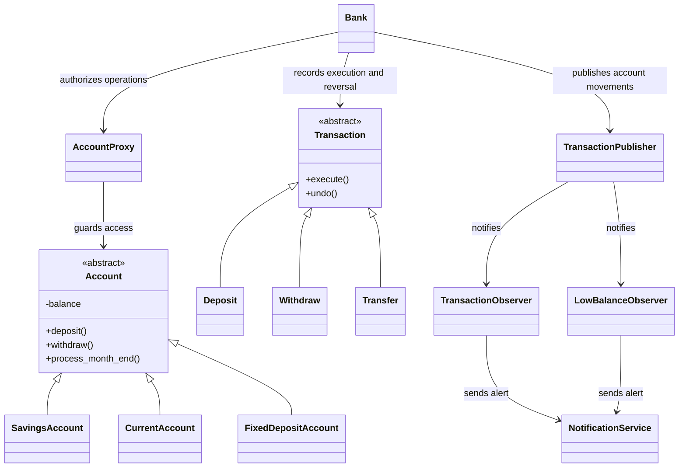

# Aster Bank project guide

Python edition

## Product rules

Balances and ledger movements use integer cents. The interface displays USD, and statement dates, withdrawal limits, and month-end periods use the Asia/Karachi calendar.

| Account | Withdrawals and transfers out | Monthly processing |
| --- | --- | --- |
| Savings | Keep at least $100 after a debit. Daily withdrawal limit of $1,000. Alerts on debits that leave less than $250. | Apply 0.25% interest. |
| Current | Balance cannot drop below $0. Daily withdrawal limit of $2,000. Alerts on debits that leave less than $200. | Apply a $12 service fee when funds are sufficient. |
| Fixed Deposit | Funds remain locked for 90 days, then a $5,000 daily withdrawal limit applies. | Generate the monthly statement. |

Withdrawals and outgoing transfers draw on the same daily allowance. The Account Proxy verifies ownership and the signed-in user’s PIN before admitting a customer operation. A teller can deposit into another customer’s account after confirming the teller’s own PIN. Admin reversal uses the administrator’s PIN and a compensating transaction. The original transaction and its reversal remain visible in the audit history. A reversal that debits an account requires sufficient funds.

## Design and code

| Requirement | Where to demonstrate it |
| --- | --- |
| Registration and login | Registration creates a customer profile with a password and six-digit PIN. Either credential can sign in. |
| Account and money operations | **Accounts** opens Savings, Current, and Fixed Deposit. Customers can deposit, withdraw, and transfer to their own or another customer’s account. |
| Encapsulation | `Account` in `aster_bank/bank.py` keeps `__balance` private and applies changes via `deposit()` and `withdraw()`. |
| Inheritance and polymorphism | `SavingsAccount`, `CurrentAccount`, and `FixedDepositAccount` inherit from `Account` and implement distinct withdrawal or monthly behavior. |
| Abstraction | `Account` and `Transaction` are abstract base classes. `Transaction` declares the `execute()` and `undo()` command contract. |
| Command | `Deposit`, `Withdraw`, and `Transfer` execute account changes. An admin reversal invokes the original command’s `undo()`. |
| Template Method | `Account.process_month_end()` runs the interest, fee, and statement steps in order. Subclasses supply the applicable interest or fee behavior. |
| Observer | `TransactionObserver` and `LowBalanceObserver` subscribe to `TransactionPublisher` and create in-app alerts. The API writes the simulated SMS/email messages to the server console after the ledger commits. |
| Protection Proxy | `AccountProxy` checks the actor, permission, and PIN before invoking the callback with the wrapped account. |
| Statements | **Statements** filters transaction movements for an account and inclusive date range and exports CSV. |
| Audit | **Admin workspace** exposes executed transaction records and reversal entries. |

The sketch contains **Transfer Funds** «include» **Authenticate** and **Reverse Transaction** «extend» **View Transaction**. The sequence diagram follows a successful transfer through the dashboard, Python server, Proxy, Command, and Observer.

- [Use case diagram](use-case.svg)
- [Transfer Funds sequence diagram](transfer-sequence.svg)

## SQLite persistence

The SQL migration creates the `banking_workspaces` table. The local workspace stores the account snapshot, command ledger, audit records, notifications, and session digests. A write starts with `BEGIN IMMEDIATE`. The server commits the updated workspace atomically, then prints the simulated SMS and email messages. A rejected transaction leaves the workspace unchanged.

## Live demo

With the Python server running, open **Demo Lab** to run the scripted examples against the sample accounts, or use the manual walkthrough below. The sample profiles share the password `AsterDemo1!`. Each transaction form requests the profile’s six-digit PIN.

| Step | Action | Expected result |
| --- | --- | --- |
| Successful transfer | As Ayesha (`ayesha@aster.demo`, PIN `123456`), transfer $75 from Savings `10003482` to Omar’s account `10005619`. Save the transaction reference. | Ayesha’s balance falls by $75. Omar’s balance rises by $75. The Activity and Notifications views show the transfer. |
| Daily-limit rejection | Withdraw $1,001 from Ayesha’s Savings using PIN `123456`. | The limit blocks the withdrawal. The balance and posted ledger remain unchanged. |
| Wrong-PIN rejection | Attempt another $10 transfer from Ayesha’s Savings using PIN `000000`. | The Proxy rejects the credential before the command executes. |
| Admin reversal | Use `admin@aster.demo` with PIN `654321`. Open **Admin workspace**, find the successful transfer by reference, and reverse it. | The transfer’s `undo()` restores the funds. Activity includes the reversal, and both transaction references are linked in the audit history. |
| Month end | In **Admin workspace**, choose **Run month-end**, select the current period, and confirm with the administrator PIN. | The run covers eligible accounts. Check the Savings interest and Current service fee on Ayesha’s monthly statements. |

A processed period cannot post a second fee or interest credit. Runs are recorded in chronological order. These examples use seeded balances. A newly registered customer can open accounts and make deposits through the regular workflow.

## Assignment coverage

The app and diagrams cover the requirements supplied in the brief. The brief references a separate **COMMON REQUIREMENTS** list. It was not included, so its items could not be checked.
